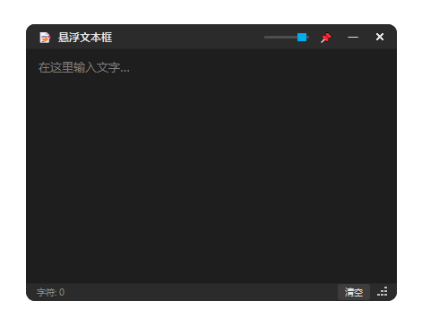

# 📝 Float TextBox

一个基于 Tauri 2 + Rust 的桌面置顶悬浮文本框，可自由调整位置和大小，支持系统托盘和透明度调节。UI 仿 B 站弹幕悬浮窗设计。


## ✨ 特性

- 🎯 **桌面置顶** - 始终悬浮在其他窗口之上
- 📐 **自由调整** - 拖动标题栏移动，右下角缩放
- 🎨 **深色主题** - 仿 B 站弹幕悬浮窗设计
- 🔍 **透明度调节** - 标题栏滑块或 Shift+滚轮
- 📌 **置顶切换** - 一键切换置顶状态
- 🗂️ **系统托盘** - 最小化到托盘，单击显示/隐藏
- ⌨️ **快捷键支持** - Ctrl+Q 退出 / Ctrl+L 清空 / Ctrl+T 切换置顶
- 🪶 **轻量紧凑** - 最小尺寸仅 160×100，打包后约 5 MB

## 📸 界面预览



## 🚀 快速开始

### 环境要求

- [Rust](https://www.rust-lang.org/tools/install) 1.75+
- [Tauri CLI](https://v2.tauri.app/start/prerequisites/) 2.x
- Windows: WebView2 Runtime（Win10/11 通常已内置）

### 开发模式运行

> 本项目前端为纯静态文件（无构建步骤），**请勿使用 `cargo tauri dev`**（它会尝试连接不存在的 dev server）。
> 直接用 `cargo run` 即可，Tauri 会通过 custom protocol 加载 `src/` 下的静态文件。

```bash
cd src-tauri
cargo run
```

### 从源码打包

```bash
cargo tauri build
```

打包产物在 `src-tauri/target/release/bundle/`。

## 📦 项目结构

```
float_textbox/
├── src/                    # 前端 (Vanilla HTML/CSS/JS，零构建)
│   ├── index.html
│   ├── style.css
│   └── script.js
├── src-tauri/              # Rust 后端
│   ├── Cargo.toml
│   ├── tauri.conf.json
│   ├── capabilities/
│   │   └── default.json    # Tauri 2 权限配置
│   ├── icons/              # 应用图标 (PNG/ICO)
│   └── src/
│       ├── main.rs
│       └── lib.rs          # 托盘/命令/事件核心逻辑
└── gen_icons.ps1           # 图标生成脚本 (PowerShell)
```

## ⌨️ 快捷键

| 快捷键 | 功能 |
|--------|------|
| **Ctrl+Q** | 退出程序 |
| **Ctrl+L** | 清空文本 |
| **Ctrl+T** | 切换置顶 |
| **Shift+滚轮** | 调整透明度 |
| 标题栏拖动 | 移动窗口 |
| 右下角三角 | 调整大小 |
| 托盘单击 | 显示/隐藏 |
| 托盘右键 | 打开菜单 |

## 🛠️ 技术栈

- **Rust** - 后端语言
- **Tauri 2** - 桌面应用框架
- **HTML / CSS / Vanilla JS** - 前端（无构建步骤）
- **PowerShell + System.Drawing** - 图标生成

## 📄 许可证

本项目基于 [MIT License](LICENSE) 开源。

## 🙏 致谢

- UI 风格参考 [bilibili-live-float](https://github.com/Dawnnnnnn/bilibili-live-float)
- 项目作者：[@s13mjl](https://github.com/s13mjl)
